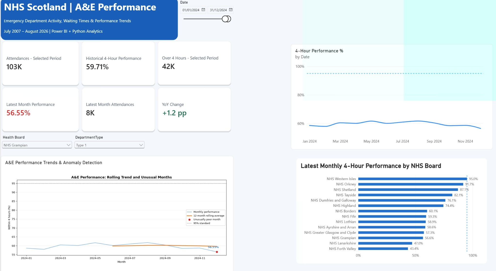

# NHS Scotland A&E Performance Dashboard

A Power BI and Python portfolio project exploring emergency department activity, four-hour performance and regional variation across NHS Scotland.

**v0.1 — initial portfolio release.** The original Python visual source has been recovered and syntax-checked. The release PBIX passes archive integrity checks. The owner confirms it contains only public PHS information and the two documented queries, and reports successful refresh and slicer checks. Independent model and Python runtime validation remain pending. This is an independent project, not an official NHS publication.

## Dashboard preview



The supplied screenshot shows NHS Grampian, Type 1, January–December 2024. Its figures describe that selected view, not Scotland as a whole. The report header states July 2007–August 2026 coverage; this awaits verification against the underlying model.

## Purpose and features

- Explore attendance volumes and the proportion of attendances completed within four hours.
- Filter by reporting period, NHS Board and department type.
- Compare selected-period metrics, latest-month performance and year-on-year percentage-point change.
- Inspect historical trends and latest-month NHS Board rankings.
- Use a Python visual to explore rolling trends and unusually poor months.

The preview displays six KPI cards, two trend visuals and a board ranking. Features are described from the supplied preview and project notes; the Python implementation has been inspected, while DAX definitions and the data model still require review.

## Technology

Power BI, Power Query, DAX, Python, pandas, NumPy and Matplotlib. `requirements.txt` lists direct Python imports without version pins; a tested environment has not yet been established.

## Repository layout

```text
README.md
.gitignore
CHANGELOG.md
docs/
  data-provenance.md
  release-checklist.md
python/                       # Original source recovered from the report
screenshots/
  dashboard-overview.jpg
NHS_AE_Dashboard_v0.1.pbix     # Reviewed release copy
requirements.txt              # Direct imports; versions not yet tested
```

## Opening the project

Open `NHS_AE_Dashboard_v0.1.pbix` in Power BI Desktop. Its saved CSV parameter is `C:\Data\nhs_ae_activity.csv` (owner-confirmed). Obtain the intended public CSV, then set `SourceCsvPath` to your own file location before refreshing. The owner reports successful refresh and date/board filter checks; these were not independently executed here.

For the recovered Python visual:

1. Install the packages listed in `requirements.txt` in the Python environment selected by Power BI Desktop.
2. Add `Date`, `NumberOfAttendancesAll` and `NumberWithin4HoursAll` from `AE_Activity` to the Python visual.
3. Paste `python/ae_performance_anomaly_detection.py` into the visual editor. Power BI supplies the `dataset` DataFrame; this is not a standalone command-line program.
4. Verify field summarisation, row deduplication and exclusion of overlapping aggregate rows before interpreting totals.

The Python file was recovered from the report definition and confirmed against the complete replacement PBIX; it was not replaced with reconstructed code. The supplied reconstructed Python and DAX examples are retained separately under `docs/reconstructed-examples/`, with their original provenance note. Those DAX definitions are not a verified export of the report model.

Syntax validation passed. Runtime checks await a Python environment containing the dependencies, and Power BI interaction tests remain outstanding.

## Data provenance and reuse

Source: Public Health Scotland, [Monthly A&E Activity and Waiting Times](https://www.opendata.nhs.scot/en/dataset/monthly-accident-and-emergency-activity-and-waiting-times), [Monthly Accident and Emergency Activity resource](https://www.opendata.nhs.scot/dataset/997acaa5-afe0-49d9-b333-dcf84584603d/resource/37ba17b1-c323-492c-87d5-e986aae9ab59). The official metadata lists the UK Open Government Licence (OGL).

> Contains public sector information from Public Health Scotland, licensed under the Open Government Licence v3.0.

The user identifies the August 2026 snapshot as the imported source; the current resource points to September 2026. The original imported CSV has not been verified. No CSV is bundled. See [data provenance](docs/data-provenance.md) and [transformation notes](docs/transformations.md) and [Power Query setup](powerquery/README.md).

The PBIX includes an imported data model. The owner confirms that it contains only public PHS information and the two reviewed queries. Its binary model has not been independently decoded. The supplied query texts and Python source have been reviewed; public-data attribution is included.

## Interpretation and known limitations

- Historical NHS Board codes and organisational changes require validation before longitudinal comparisons are treated as reliable.
- Date filtering restricts the history available to the Python visual. Its rolling calculations and anomaly flags may be unreliable for short selected periods; the exact window and minimum-observation rules await script review.
- Missing observations must be distinguished from zero values. The original script uses default sums, drops non-positive attendance totals and has no empty-result guard before annotating the final row; these remain validation tasks.
- Latest-month and year-on-year measures require verification across date, board and department filters.
- The screenshot contains a 95% reference line. Its policy definition and applicability require confirmation against the dataset documentation. Anomaly flags are exploratory statistical indicators, not clinical assessments.
- National performance should be calculated from relevant attendance totals, rather than a simple average of board percentages; the model calculation remains to be checked.

## Remaining work

1. Complete repository documentation, source review and the v0.1 GitHub release.
2. Validate historical NHS Board mappings and missing-data handling.
3. Improve rolling calculations and anomaly detection for short date ranges.
4. Finish visual polish and test slicers, KPI calculations and refresh behaviour.

## Licence

No project licence has been selected yet. Dataset and third-party rights remain separate from any future code licence. Confirm permissions before reusing or redistributing the materials.
